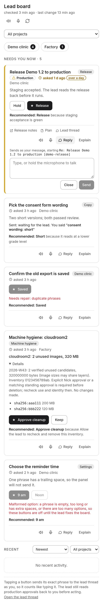
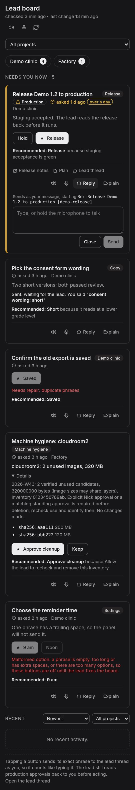

# Decision card

One design for a decision the lead needs from Nick, shared by the Lead board
panel and the bb-voice app. It describes what a card shows and does, not how a
platform draws it. Both read the same feed: `decisions[]` in `board.json`
(schemas 1 and 2, `docs/board-schema.md`).




## Order

Cards are listed most urgent first: production, security and unrecognised
risk, then everything else; oldest first within each group. Ties keep the
feed's order.

## Anatomy, top to bottom

1. **Urgency edge.** A coloured edge on the leading side when the risk is
   `production`, `security`, `money` or unrecognised. The risk badge says the
   same in words.
2. **Title**, linked when the decision has a `link`. **Tag** at the trailing
   side: `tag`, or the project's display name when the tag is empty, or
   "Machine hygiene" for a hygiene card.
3. **Meta line:**
   - **Risk badge** (warning icon + word): Production, Security, Money,
     Staging or Unrecognised risk. No badge for `none`.
   - **Age:** clock icon + "asked N ago" from `createdAt` ("just now", "12 min
     ago", "3 h ago", "2 d ago"). Over 24 hours it is emphasised and gains an
     "over a day" flag.
   - **Project** display name, where cards from several projects are mixed.
4. **Context.** URLs and thread ids in it are links. A machine-hygiene card
   (`tag: machine-hygiene`) shows one summary line instead, such as
   "cloudroom2: 6 unused images, 705 MB", with the inventory and policy text
   under a collapsed **Details**.
5. **Options:** one button per option, in feed order. The recommended option
   is filled (primary style) and starts with **★**; the others are outlined.
6. **Recommendation:** "**Recommended: <label>** because <why>" (a leading
   "because" in `why` is not repeated).
7. **Links:** each `links[]` entry as a small labelled link with an icon for its
   kind (below).
8. **Actions:** read aloud, push-to-talk, **Reply** and **Explain**, at the
   trailing side.
9. **Reply box** (when open): the reference line it will start with, a text
   box, and Close / Send.

## Links

| `href` form | Opens | Icon |
| --- | --- | --- |
| `https://…` | the browser | external arrow |
| `thread:thr_…` | that bb thread (never built into a URL) | speech bubble |
| `file:<absolute path>` | a file preview: a path under `thread-storage/<thread>/` in that thread's storage, any other path on the board host | page |
| `repo:<project>/<path>` | nothing: the feed converts these to GitHub URLs; an unconverted one is plain text | none |

Anything else is plain text.

## Icons and labels

Every icon-only control has an accessible label and a tooltip with the same
words.

| Icon | Label | Does |
| --- | --- | --- |
| Speaker | "Read this card aloud" / "Stop reading this card" | Reads the title, the context (or the hygiene summary), the options, then "Recommended: <label>, because <why>." |
| Microphone | "Hold to talk about: <title>" / "Recording… release to stop" / "Transcribing…" | Hold to record; the text is added to this card's reply box for editing. |
| Speech bubble + "Reply" | "Reply: <title>" | Opens the reply box. |
| "Explain" | "Explain: <title>" | Sends `explain <decision id>`. |
| ★ | (part of the option's label) | Marks the recommended option. |
| Warning triangle | (part of the risk badge) | Marks a risk. |
| Clock | (part of the age) | Marks the age. |

The panel header keeps a speaker ("Read aloud" for every card) and a
microphone ("Hold to talk", a note not tied to a card).

## What a card sends

Everything is sent as Nick's own message to the lead thread, and only when
Nick acts. Nothing is sent automatically.

- **Option:** its `phrase`, exactly as the feed wrote it. Production,
  security, money and unrecognised risks ask for confirmation first.
- **Explain:** `explain <decision id>`. No confirmation; the card is unchanged.
- **Reply:** a reference line, then Nick's text:

  ```
  Re: <card title> [<decision id>]
  <Nick's text>
  ```

  Dictated text fills the same box for editing. The unsent draft is kept per
  card on the device until it is sent. Replies to an activity row start
  `Re: <event text> [<project> <kind> <time>]`.

## States

| State | When | Shows |
| --- | --- | --- |
| Ready | default | the options, enabled |
| Sending | an option is being sent | the options disabled |
| Sent | after an option was sent | "Sent: waiting for the lead. You said "<phrase>"" instead of the options, until the feed drops or changes the decision |
| Malformed | an empty phrase, one with leading or trailing spaces, one over 500 characters, more than 8 options, or none | the options disabled, with "Malformed option: …" |
| Needs repair | `invalidLegacy` | the options disabled, with "Needs repair: <invalidReason>" |
| Unreadable | the decision could not be parsed | "Needs repair: the panel could not read this decision"; no options and no actions |

Long text is clipped for display only (limits in `schemas/board-limits.json`);
phrases are never altered.

## Voice

Reading aloud uses bb-voice's Cartesia voice where the board host has it, and
otherwise the best installed voice for the user's language (Premium,
Enhanced, Natural or neural voices first), with a voice picker.
