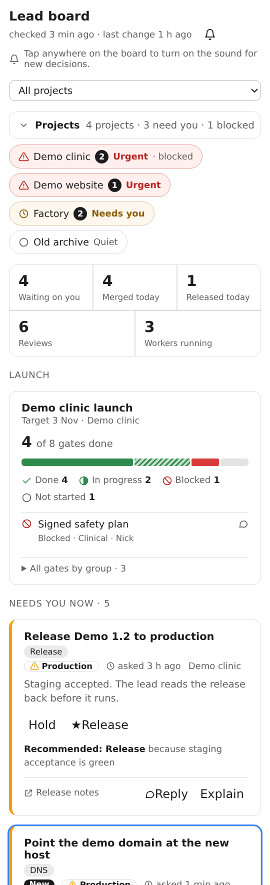
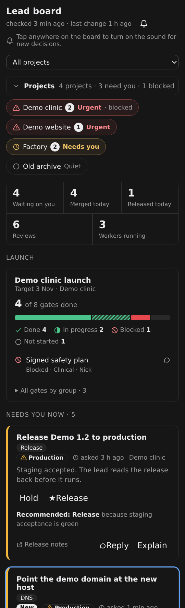
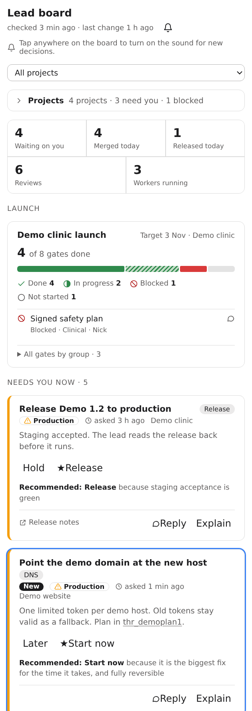
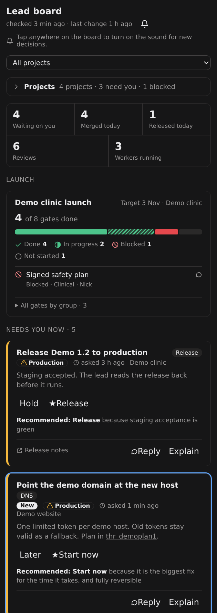

# Lead board (bb plugin)

A bb panel that shows the decisions the factory lead needs from Nick, with the
lead's recommendation on every option, and the factory's activity around them.
It reads the `factory board` state (`~/.local/state/factory/board.json` on
cloudroom3, schema 1 from TYP-1568 or schema 2 from TYP-1795) and stays in step
with the lead by polling it every 20 seconds.

## Surfaces

- **Thread side panel:** in the lead thread, open the right panel, choose
  New tab, then **Lead board** under Actions.
- **Sidebar page:** `/plugins/lead-board/board`, for a full-width view.
  `?project=<id>` (or the `project/<id>` sub-path the page navigates to)
  opens one project's view.

## Views (schema 2)

- **Home:** the project list, a stats
  strip (waiting on you, merged and released today, reviews, workers
  running), the launch gauges, **Needs you now**, **Recent** and a done-today
  strip. A schema 1 board shows Needs you now, Coming up, In flight and Done
  today, as before.
- **Project list:** collapsed by default to one line, such as "12 projects ·
  2 need you · 1 blocked" (blocked: a project with a blocked in-flight item).
  It opens on click or tap and remembers open or closed for the window
  (session storage). Each chip shows the decisions waiting and a status,
  derived from the feed: **Urgent** (a waiting decision with production,
  security, money or unrecognised risk; destructive colour, warning icon),
  **Needs you** (any other waiting decision; warning colour, clock),
  **Active** (work in flight, a merge today or any activity in 24 hours;
  success colour, half-filled circle) or **Quiet** (nothing in 24 hours;
  muted, empty circle). Colour is never the only signal: every chip has the
  icon and the word, and its accessible name spells it out. Chips are ordered
  by status, then name.
- **Project view:** that project's decisions, stats, launch gates, in-flight
  work, coming-up items and recent activity. The side panel has a project
  switcher; the sidebar page uses the chips and a back link.
- **Needs you now** is ordered production, security (and unrecognised risk)
  first, then oldest. Each card shows "asked N ago"; over 24 hours it is
  flagged "over a day".
- **Recent** sorts: Newest (default); Oldest waiting (blocked events, longest
  waiting first, then the rest newest first); By project (feed order); Needs
  Nick first (events from projects with a waiting decision first). The home
  page also filters by project.
- **Launch gauge:** a segmented bar of the launch's gates (done, in progress,
  blocked, not started), a legend with icons and counts, blocked gates listed
  first, and per-group bars under "All gates by group". Status is shown by
  icon and label as well as colour. Tapping a gate opens its link.
- **Machine hygiene** cards (`tag: machine-hygiene`) show one summary line,
  such as "cloudroom2: 6 unused images, 705 MB", with the inventory collapsed.
- bb's plugin SDK has no tab badge for panel tabs, so the waiting count is
  shown in the page instead.

## Behaviour

- **Explain** on a card posts `explain <decision id>` to the lead thread. It
  answers nothing, so it needs no confirmation and leaves the card as it was.
- Links: `https://` links open with bb's browser preference; `thread:thr_…`
  opens the thread and `file:<absolute path>` opens bb's file preview (a path
  under `thread-storage/<thread>/` opens in that thread's storage, any other
  on the board host). A `repo:` link the feed did not convert, or any other
  form, stays plain text. URLs and thread ids in a card's context are linked
  the same way.
- Tapping an option posts its `phrase`, verbatim, to the lead thread with
  `useSdk().threads.send` under the signed-in user's session, so it is Nick's
  own message. It queues if the lead is mid-turn.
- `risk` of `production`, `security` or `money` opens a confirmation dialog
  first. The plugin never approves anything itself; the lead's read-back
  rules still apply.
- A sent card shows "Sent: waiting for the lead" until the board drops the
  decision or changes it; nothing else clears it. One store per window
  (`components/sent-store.ts`, persisted to local storage) holds the marks and
  the sends in flight, so every open panel shows the card as sent and a
  second tap anywhere sends nothing.
- Phrases are kept exactly as the feed wrote them, in what the panel shows and
  sends. An empty phrase, one with leading or trailing whitespace or one over
  the feed's 500-unit limit, or a decision with more than 8 options, disables
  that decision's buttons with a "malformed option" note.
- A legacy decision TYP-1568 marks `invalidLegacy` shows "Needs repair:
  <invalidReason>" with every option disabled; it is never sendable. Each
  decision parses on its own, so one the panel cannot read becomes a
  needs-repair card instead of hiding the board.
- Field lengths are never a parse error. Long text is clipped for display
  only, using `BOARD_LIMITS` in `lib/board.ts` (UTF-16 units). It mirrors
  `schemas/board-limits.json` (TYP-1568, schema 2 fields from TYP-1795);
  `lib/board-limits.test.ts` fails on drift. Until the schema 2 file is in
  the repo it only checks the schema 1 limits are contained;
  `BOARD_LIMITS_FILE=<path> npx vitest run lib/board-limits.test.ts` checks
  another copy exactly. Phrases are always sent whole.
  Legacy `needs add` asks arrive as ordinary single-option
  decisions; an empty tag falls back to the project.
- Freshness: a schema 2 board shows "checked N min ago · last change M min
  ago" and a stale banner only when `checkedAt` is over 10 minutes old. A
  schema 1 board shows "updated N min ago" and the banner after 15 minutes
  without an update. A read
  or parse failure shows an error and keeps the last good board.
- Every card has **Reply** (and so does every recent-activity row): an inline
  box whose text is sent, only on **Send**, as Nick's message starting
  `Re: <card title> [<decision id>]`. Unsent drafts stay in local storage per
  card. The card design is written down in [CARD.md](CARD.md) for the bb-voice
  app to share.
- Voice controls (setting `voice`, off by default): the header has **Read
  aloud** and **Hold to talk** icons, and each card a speaker (reads that card)
  and a microphone (dictates into that card's reply box). Push-to-talk
  transcribes with bb's configured voice service
  (`sdk.system.transcribeVoice`), or the browser's Web Speech API when
  recording or bb transcription is unavailable; the text is always shown for
  editing and sent only when Nick presses Send.
- Reading aloud uses bb-voice's Cartesia voice when the board host has it. The
  plugin's host entry (`host.ts`) runs on the board host, reads
  `CARTESIA_API_KEY` and `CARTESIA_VOICE_ID` from bb-voice's
  `~/.config/bb-voice/brain.env` (or `$BB_VOICE_ENV_FILE`) at call time, and
  returns only mp3 audio through the plugin server; the key never leaves that
  host and is not a plugin setting. Clips are cached on the host by their
  text. Without that voice the panel uses the best installed browser voice
  for the user's language (Premium, Enhanced, Natural or neural first) and
  shows a **Reading voice** picker.

- **Refresh** (header, circular arrows): re-reads board.json at once, then
  asks the board host to rebuild the feed now. The host entry runs one fixed
  command, `/home/agent/code/factory/bin/factory board refresh`, with no
  shell; the rpc takes no input, so the panel can never choose the command
  or its arguments. That command always writes `board.json` in factory's
  state directory (`$FACTORY_STATE_ROOT`, else
  `${XDG_STATE_HOME:-~/.local/state}/factory`), so the host runs it only when
  the `boardPath` setting is that same file (symlinks followed) and otherwise
  shows an error naming both paths. The server allows one rebuild per 15 seconds (a tap
  inside that window says when to try again) and joins a tap made while one
  runs. The icon spins while it runs, and the board is read again when it
  finishes. A failure is shown under the header and the last good board stays.
- **New-decision sound:** when a poll shows a decision id the panel has not
  seen since it opened, it plays a short two-note chime made with WebAudio
  (no audio files) and highlights the new card, with a "New" badge, for 10
  seconds. Never on the first load, at most one chime per poll however many
  are new, and once per id per window, so two open panels do not both chime.
  The bell in the header mutes it (kept in local storage). Browsers only
  allow audio after a user gesture, so the sound arms on the first tap or key
  press in the window, with a small hint until then. It only works while a
  Lead board panel is open (and the board is polled only while visible); it
  is not a notification.






These four come from a standalone harness with stand-in theme tokens, so
bb's own button and icon styles are missing from them.

## Settings

`bb plugin config lead-board` shows them; the three required settings have no
defaults. Until all are set (and valid) the panel shows "Not configured" and
neither polls nor sends anything.

| Key | Example | Meaning |
| --- | --- | --- |
| `boardHostId` | `host_…` | Host that holds board.json |
| `boardPath` | `/path/to/board.json` | Absolute path on that host |
| `leadThreadId` | `thr_…` | Thread that receives option phrases |
| `voice` | `false` (default) | Show the voice controls |

## Develop

```sh
npm install --include=dev
npm test            # vitest + the bb plugin test harness
npx tsc --noEmit
bb plugin build .
```

On cloudroom3 the bb CLI's own npm lookup fails during the first build
(`Cannot find module 'npm/package.json'`). Run the build with the system npm
on the module path: `NODE_PATH=/usr/local/lib/node_modules bb plugin build .`

## Install (Nick's step)

Installing needs Nick's approval. Once the branch is merged and on GitHub:

```sh
bb plugin install git:https://github.com/1nickfisher/agent-factory.git@main --subdirectory plugins/lead-board
bb plugin config lead-board        # check the defaults above
```

The bb server needs read access to the repository for a git install.
